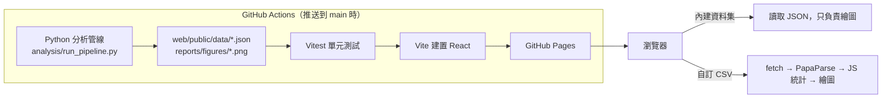

# CRISP-DM 線性回歸分析網站

物聯網應用與資料分析 HW2。依 CRISP-DM 六個步驟，用線性回歸（單純線性回歸、多元線性回歸、Auto Regression）分析兩個 Kaggle 公開資料集，並提供「自訂 CSV URL」功能，可以即時檢視任意 CSV 資料集的基本資訊。

**repo：<https://github.com/superMLK/iot-hw2/>**
**demo網站：<https://supermlk.github.io/iot-hw2/>**

- 下拉選單切換兩個內建資料集，每個資料集都有 CRISP-DM 六個步驟的完整內容。
- 特徵選擇使用三種方法（相關係數、VIF、逐步回歸），並比較每個特徵在各方法中是否被保留。
- 預測圖同時畫出 95% 信賴區間與 95% 預測區間（AR 模型只有預測區間）。
- 自訂 CSV：輸入網址或上傳檔案，在瀏覽器中計算欄位型別、缺失值、敘述統計、相關係數與分布，資料不會上傳。

## 資料集

<!-- DATASETS:START -->
| 資料集 | 來源 | 授權 | 筆數 | 特徵數 | 目標變數 |
|---|---|---|---:|---:|---|
| Bike Sharing（每日租借量） | [Kaggle](https://www.kaggle.com/datasets/lakshmi25npathi/bike-sharing-dataset)／原始出處 [UCI](https://archive.ics.uci.edu/dataset/275/bike+sharing+dataset) | CC BY 4.0（UCI 原始出處；Kaggle 頁面標示為 Unknown） | 731 | 14 | `cnt` |
| King County 房價 | [Kaggle](https://www.kaggle.com/datasets/harlfoxem/housesalesprediction) | CC0: Public Domain | 21,613 | 19 | `price` |
<!-- DATASETS:END -->

特徵數 = 原始欄數 − 目標變數 − ID 欄，兩者都符合作業「大於 13、小於 40」的要求。授權於 2026-11-02 查閱 Kaggle 與 UCI 頁面確認，記錄在 `analysis/datasets.yaml`。

Bike Sharing 資料引用：Fanaee-T, H., & Gama, J. (2013). Event labeling combining ensemble detectors and background knowledge. *Progress in Artificial Intelligence*, 2, 113–127.

## 架構



- **內建資料集**：所有分析在建置時由 Python 完成，前端只讀 JSON 呈現。CRISP-DM 文字寫在 `analysis/content/*.yaml`，結果數字以佔位符代入，網站、README、Word 報告與資訊圖表的數字都來自同一次管線輸出。
- **自訂 CSV**：完全在瀏覽器中處理，不需要後端。

## 本機執行

需要 Python 3.11 與 Node.js 20.19 以上（建議 LTS）。

```bash
# 1. 分析管線
python3.11 -m venv .venv
source .venv/bin/activate          # Windows：.venv\Scripts\activate
pip install -r requirements.txt
python analysis/run_pipeline.py     # 產生 web/public/data/*.json 與 reports/figures/*.png
python -m pytest analysis/tests     # 管線測試

# 2. 前端
cd web
npm ci
npm run test                        # 單元測試（需要先完成步驟 1）
npm run dev                         # 開啟 http://localhost:5173/
```

更新 README 的結果表：`python reports/update_readme.py`。

## 部署

`.github/workflows/deploy.yml` 在推送到 `main` 時依序執行：安裝 Python 套件 → 執行分析管線 → 管線測試 → `npm ci` → 前端測試 → 建置 → 發布到 GitHub Pages。任一步驟失敗就不會部署，網站維持上一個成功版本。

- 管線輸出（`web/public/data/`）不進版控，每次部署都重新產生。
- Vite 的 `base` 由 CI 的 `GITHUB_REPOSITORY` 自動設成 `/<repo>/`，本機預設為 `/`。
- 重新訓練：更新 `analysis/data/raw/` 中的 CSV 後推送即可。管線使用固定亂數種子（42），同一份資料重跑結果相同。

## CRISP-DM 六步驟摘要

1. **業務理解**：Bike 預測每日租借量，作為車輛調度與維修排程的依據；House 依房屋條件估算合理成交價，幫助買賣雙方判斷開價。兩者都設定測試集 R² 作為成功標準，並要求 95% 預測區間的覆蓋率接近 95%。
2. **資料理解**：檢查筆數、型別、缺失值、重複列、敘述統計與相關係數矩陣。Bike 的 `casual`、`registered` 與 `cnt` 高度相關，因為兩者相加就是 `cnt`；House 的房價明顯右偏。
3. **資料準備**：Bike 移除會造成資料洩漏的 `casual`、`registered`，類別欄做 one-hot，並依時間順序切分 80/20。House 移除異常值、處理完全共線的欄位、以經緯度取代 zipcode、目標取 log，隨機切分 80/20。
4. **建模**：在訓練集上依序做相關係數篩選、VIF 迭代移除、以 AIC 為準則的雙向逐步回歸，最終特徵集採用逐步回歸的結果。Bike 建立 SLR、兩個 MLR 與 AR(p)；House 建立 SLR 與兩個 MLR。
5. **評估**：比較測試集的 R²、Adjusted R²、RMSE、MAE、預測區間覆蓋率與 5 折交叉驗證，並以殘差圖、Q-Q 圖、殘差直方圖檢查模型假設。House 的 RMSE、MAE 換算回美元。
6. **部署**：GitHub Actions 自動重跑管線並部署到 GitHub Pages。網站上列出模型的限制，例如時間外推、地點資訊不足，以及非線性關係無法表達。

## 主要結果

<!-- RESULTS:START -->
**Bike Sharing（每日租借量）**（目標：`cnt`；特徵選擇 28 → 21 個）

| 模型 | 測試集 R² | Adjusted R² | RMSE | MAE | 95% 預測區間覆蓋率 | 5 折 CV R² |
|---|---:|---:|---:|---:|---:|---:|
| 單純線性回歸（atemp） | -0.487 | -0.497 | 2,286 | 2,049 | 67.3% | -1.544 ± 1.324 |
| 多元線性回歸（全部 28 個特徵） ⭐ 最佳 | 0.654 | 0.572 | 1,103 | 804 | 85.7% | -0.834 ± 1.027 |
| 多元線性回歸（選擇後 21 個特徵） | 0.654 | 0.595 | 1,103 | 818 | 85.0% | -0.719 ± 1.368 |
| Auto Regression AR(11) | 0.574 | 0.540 | 1,223 | 841 | 85.7% | 0.087 ± 0.214 |

成功標準：測試集 R² ≥ 0.70，未達標。

**King County 房價**（目標：`price`；特徵選擇 28 → 20 個）

| 模型 | 測試集 R² | Adjusted R² | RMSE（美元） | MAE（美元） | 95% 預測區間覆蓋率 | 5 折 CV R² |
|---|---:|---:|---:|---:|---:|---:|
| 單純線性回歸（sqft_living） | 0.480 | 0.480 | 258,633 | 162,660 | 95.5% | 0.484 ± 0.006 |
| 多元線性回歸（全部 28 個特徵） ⭐ 最佳 | 0.764 | 0.762 | 174,728 | 108,750 | 94.2% | 0.773 ± 0.003 |
| 多元線性回歸（選擇後 20 個特徵） | 0.763 | 0.762 | 175,031 | 108,815 | 94.2% | 0.772 ± 0.003 |

成功標準：測試集 R²（log 尺度） ≥ 0.80，未達標。R²、Adjusted R² 與交叉驗證 R² 以 log(price) 計算；RMSE、MAE 以原始價格（美元）計算。
<!-- RESULTS:END -->

## 目錄結構

```
.
├─ analysis/
│  ├─ data/raw/            # day.csv、kc_house_data.csv
│  ├─ datasets.yaml        # 資料集中繼資料（連結、授權、目標變數、網站網址）
│  ├─ content/             # CRISP-DM 文字內容（網站與報告共用，數字以佔位符代入）
│  ├─ pipeline/            # 依 CRISP-DM 階段拆分的模組
│  ├─ tests/               # 管線測試（pytest）
│  └─ run_pipeline.py      # 進入點：輸出 JSON 與 PNG
├─ web/                    # React 18 + Vite + TypeScript
│  ├─ src/
│  │  ├─ steps/            # CRISP-DM 各步驟頁面
│  │  ├─ components/       # 圖表、表格、預測圖等共用元件
│  │  ├─ custom/           # 自訂 CSV 檢視
│  │  └─ lib/stats/        # 統計純函式（Vitest）
│  └─ public/data/         # 管線輸出（CI 產生，不進版控）
├─ reports/
│  ├─ figures/             # 管線輸出的 PNG
│  ├─ build_report.py      # 產生 Word 報告
│  ├─ infographic/         # A4 資訊圖表模板與產生器
│  ├─ update_readme.py     # 更新本檔的結果表
│  └─ output/              # report.docx、infographic.pdf、infographic.png
├─ openspec/               # 需求規格與變更紀錄
├─ design.md               # 原始技術設計
├─ .github/workflows/deploy.yml
└─ README.md
```
